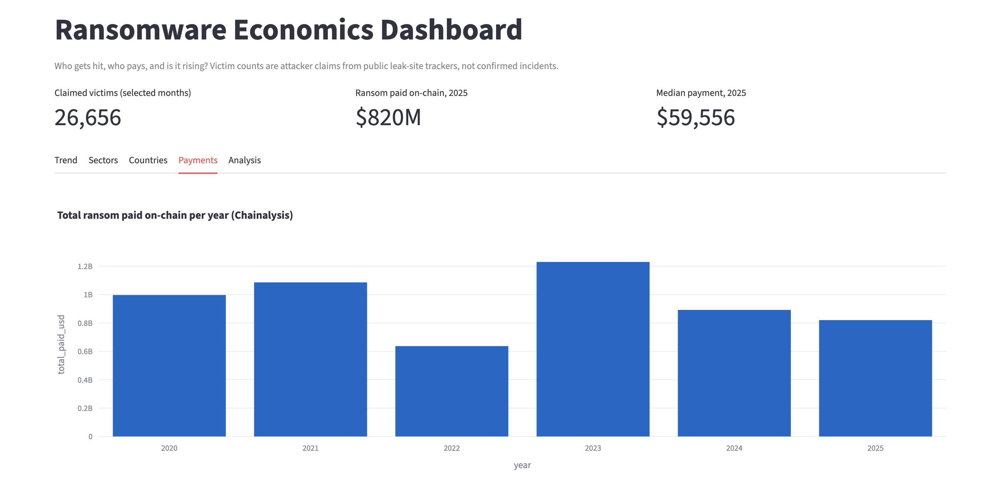

# Ransomware Economics Dashboard

## Bottom line

Ransomware is rising in volume and earning less per attack. Claimed victims rose about 66% from 2023 to 2025, while on-chain payments fell by a third and the share of victims who pay dropped to a record-low 23%. Professional services, manufacturing and technology are hit hardest. The United States has by far the most victims, but adjusted for economy size, mid-sized economies such as Thailand, Malaysia and Argentina are hit harder. A handful of groups, led by Qilin, account for most of the activity.

Live dashboard: https://fosu-ransomware-economics.streamlit.app/

## Findings

1. The threat is rising. Claimed victims went from 4,904 in 2023 to 5,979 in 2024 (+22%) and 8,136 in 2025 (+36%). Growth sped up rather than leveling off. High confidence that leak-site activity is rising. Because victims who pay quickly are rarely posted, the true number of attacks is higher than these counts.

2. Three sectors take the most hits. Professional services (5,198), manufacturing (4,653) and technology (3,476) lead. These sectors tend to hold client data, depend on uptime and have thin IT budgets, which makes them likely to pay and easy to pressure. Moderate confidence. Sector labels come from attacker claims and tracker classification, so the boundaries between categories are imprecise.

3. The US leads in raw counts, but not by size. The US has 4,051 victims, about 8.5 times Germany’s 479. Per $100B of GDP, however, the US ranks only 10th (13.8). Seven of the per-GDP top 10, including Thailand (21.5), Malaysia (19.2) and Argentina (16.9), don’t appear in the raw top 10 at all. Canada is the only country besides the US on both lists and has a higher rate (15.7). Moderate confidence. With counts of 40 to 110 victims, a few dozen victims can reshuffle the per-GDP ranks. The 618 “Unknown” victims are also larger than any country except the US, which could move these rankings.

4. Activity is concentrated. Five groups, Qilin (2,336), Akira (1,632), LockBit 3 (1,598), Play (1,288) and Clop (1,174), drive most of the volume. LockBit 3 was disrupted by law enforcement in February 2024, so its total is likely weighted toward 2023 and early 2024. A breakdown by year would show whether Qilin took over its share.

5. Victims are rising while payments fall. Total paid fell from $1.23B to $892M to $820M. Dividing payments by claimed victims gives about $251K per claimed victim in 2023, $149K in 2024 and $101K in 2025, a 60% drop. Moderate confidence that ransomware is becoming a high-volume, lower-yield business. This is a yield index, not an average ransom, because most posted victims are the ones who refused to pay.

## How it works
src/collect.py downloads data -> src/clean.py cleans it into SQLite and exports
summary tables -> app.py (Streamlit + Plotly) displays them.

## Run it yourself

- pip install -r requirements.txt
- python src/collect.py
- python src/clean.py
- streamlit run app.py

## Limitations

**Victim counts are attacker claims, not confirmed incidents.**
All victim data comes from Ransomware.live, which tracks what ransomware groups post on their leak sites. Groups sometimes exaggerate, post the same victim twice, repost old victims under a new name after rebranding, or list organizations that were never actually breached.

**Leak-site data undercounts the real number of attacks.**
Victims who pay quickly are usually never posted, so the organizations that paid are largely missing from the victim counts. Some groups don't run leak sites at all.

**Part of the rise may be better tracking, not more attacks.**
Ransomware.live adds new groups and leak sites over time. Some of the year-over-year increase may reflect wider coverage rather than more attacks.

**Dates reflect when a victim was posted, not when the attack happened.**
Posting usually comes days or weeks after the intrusion, so monthly figures are shifted later than the real attack timeline.

**Sector and country labels are imperfect.**
Labels come from the tracker's classification of each victim, not from the victims themselves. A large share of victims (618 in the last 12 months) have no known country. Multinational companies are counted in a single country.

**Per-GDP rankings are sensitive to small numbers.**
Countries with fewer than 20 claimed victims are excluded. Even above that threshold, a few dozen victims can change a country's rank. A high per-GDP rate indicates exposure relative to economy size, not weaker security.

**Payment data comes from different sources than victim data.**
- *Chainalysis* totals cover only ransom payments traceable on the blockchain. Chainalysis revises past figures upward as it identifies more wallets, so recent years may be revised later.
- *Coveware* payment rates come from Coveware's own incident-response cases, not from the leak-site victims counted here.

Because of this, the dashboard does not estimate how many listed victims paid, and "paid per claimed victim" is a rough yield index, not an average ransom.

**Payment figures are manually transcribed.**
Chainalysis and Coveware publish reports, not data feeds. Their figures were typed in by hand from published reports and are cited row by row in `data/manual/`. They update only when those reports come out, not monthly.

**Time windows differ between views.**
Country figures cover the last 12 months; sector and group totals cover the full dataset. The current month is always incomplete and is excluded from trend charts.

**The project shows patterns, not causes.**
The dashboard shows that victim counts rose while payments fell. It does not prove why. Explanations such as better backups, law-enforcement pressure or sanctions are hypotheses.

**This is an independent project using only public data.**
It does not use any non-public, proprietary or government data, and victim names are not published.